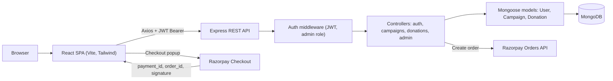

# CrowdFundX

A full-stack MERN crowdfunding platform where people start fundraising campaigns, donate through Razorpay, and administrators moderate users, campaigns and donations.


## Overview

Community fundraising (medical bills, school supplies, local projects) often happens over messaging groups and personal bank transfers, with no shared view of how much has been raised or who gave. CrowdFundX puts this on a single web platform:

- **Campaign creators** publish a campaign with a goal amount, deadline, category and cover image.
- **Donors** browse and search campaigns, then pay through the Razorpay checkout. Each verified payment is recorded and added to the campaign's progress bar.
- **Administrators** get a separate panel with platform statistics, a donations chart, user management (ban/delete), campaign moderation and a donation monitor that flags unusually large payments.

The project is a portfolio and academic prototype (a code comment in the payment controller refers to it as a college final-year project demo). The frontend is set up for deployment on Vercel ([`client/vercel.json`](client/vercel.json)).

## Key features

| Area | What is implemented |
|---|---|
| Authentication | Register and log in with email and password. Passwords are hashed with bcrypt; the API issues a JWT valid for 30 days, which the client stores in `localStorage` and sends as a `Bearer` token. |
| Roles | `user` and `admin` roles. Protected React routes for logged-in users and a separate guarded `/admin` area. Admin API routes are protected by JWT plus an admin-role middleware. |
| Campaigns | Create, view, update and delete (owner or admin only). Six categories: Medical, Education, Environment, Technology, Community, Other. Cover image is provided as a URL. |
| Discovery | Campaign list with title search (debounced), category filter and sorting by newest, most raised or nearest deadline. |
| Donations | Razorpay order creation on the server, Razorpay Checkout in the browser, HMAC-SHA256 signature verification on the server, then a `Donation` record is saved and the campaign's `raisedAmount` is increased. Currency is INR. |
| User dashboard | "My Campaigns" and "My Donations" tabs. |
| Admin panel | Stats cards (users, campaigns, active/completed campaigns, donations, total funds), a bar chart of donations over the last six months (Recharts), the five most recent transactions, paginated user search, ban/unban and delete users, change campaign status or delete campaigns, and a donation list where donations above 50,000 are flagged as suspicious. |
| Seed data | Scripts that load demo users, campaigns and donations into MongoDB. |

## Architecture



**React client (`client/`)**: a single-page app built with Vite and React Router. `AuthContext` keeps the logged-in user (including the JWT) in React state and `localStorage`. All API calls go through one Axios instance ([`client/src/services/api.js`](client/src/services/api.js)) that attaches the token automatically. Pages cover the public site (home, campaign list, campaign details), the user area (dashboard, create campaign) and the admin panel (dashboard, users, campaigns, donations).

**Express API (`server/`)**: a REST API with four route groups mounted in [`server/server.js`](server/server.js). It uses `helmet` for security headers, permissive CORS, a request logger and a JSON error handler. Routes delegate to controllers, which use Mongoose models.

**MongoDB**: three collections. `User` (name, email, hashed password, role, ban flag), `Campaign` (title, description, goal and raised amounts, image URL, category, creator, approval and status fields, deadline) and `Donation` (donor, campaign, amount, Razorpay payment and order IDs, status).

**Razorpay**: the server creates orders with the Razorpay Node SDK and verifies the payment signature; the browser loads Razorpay Checkout to collect the payment.

## How it works

### Donation flow

1. A logged-in donor opens a campaign and enters an amount.
2. The client calls `POST /api/donations/create-order`; the server creates a Razorpay order in INR (amount converted to paise) and returns it.
3. The client opens Razorpay Checkout with the order ID.
4. After payment, Razorpay returns `razorpay_order_id`, `razorpay_payment_id` and `razorpay_signature` to the browser.
5. The client sends these, plus the campaign ID and amount, to `POST /api/donations/verify`.
6. The server recomputes `HMAC_SHA256(order_id + "|" + payment_id)` with `RAZORPAY_KEY_SECRET` and compares it with the signature. On a match it stores a `Donation` and adds the amount to the campaign's `raisedAmount`.
7. The client reloads the campaign so the progress bar reflects the new total.

### Authentication flow

1. `POST /api/auth/register` or `POST /api/auth/login` returns the user profile and a JWT.
2. The client saves the response in `localStorage`.
3. The `protect` middleware verifies the token on private routes and loads the user; the `admin` middleware additionally requires `role === "admin"`.

## Tech stack

| Layer | Technologies |
|---|---|
| Frontend | React 18, Vite 6, React Router 6, Tailwind CSS 3, Framer Motion, Recharts, Axios, lucide-react, react-hot-toast |
| Backend | Node.js, Express 5, Mongoose 9, jsonwebtoken, bcryptjs, helmet, cors, dotenv |
| Database | MongoDB (local or Atlas) |
| Payments | Razorpay Node SDK and Razorpay Checkout |
| Tooling | nodemon, ESLint |
| Hosting config | Vercel SPA rewrites for the client |

## Project structure

```
CrowdFundX/
├── client/                      # React frontend (Vite)
│   ├── index.html               # Loads the Razorpay Checkout script
│   ├── vercel.json              # SPA rewrite rule for Vercel
│   └── src/
│       ├── App.jsx              # Route table (public, user, admin)
│       ├── context/AuthContext.jsx   # Login/register/logout state
│       ├── services/api.js      # Axios instance with JWT interceptor
│       ├── components/          # Navbar, CampaignCard, route guards, admin sidebar/cards
│       └── pages/               # Home, Campaigns, CampaignDetails, CreateCampaign, Dashboard, Login, Register
│           └── admin/           # AdminDashboard, UsersPage, CampaignsPage, DonationsPage
└── server/                      # Express API
    ├── server.js                # App setup and route mounting
    ├── config/db.js             # MongoDB connection
    ├── models/                  # User, Campaign, Donation schemas
    ├── controllers/             # auth, campaign, donation, admin logic
    ├── routes/                  # /api/auth, /api/campaigns, /api/donations, /api/admin
    ├── middleware/              # JWT protect and admin role check
    ├── utils/generateToken.js   # JWT signing (30-day expiry)
    ├── seeder.js                # Wipes and seeds users and campaigns
    ├── seedDonations.js         # Seeds sample donations
    └── debug_db.js              # Quick database connectivity check
```

## Getting started

### Prerequisites

- Node.js and npm
- A MongoDB instance (local or MongoDB Atlas)
- A Razorpay account in test mode (optional for local demos, see the note under Limitations)

### 1. Backend

```bash
cd server
npm install
```

Create `server/.env` with these variables:

| Variable | Purpose |
|---|---|
| `MONGO_URI` | MongoDB connection string |
| `JWT_SECRET` | Secret used to sign and verify JWTs |
| `RAZORPAY_KEY_ID` | Razorpay key ID used to create orders |
| `RAZORPAY_KEY_SECRET` | Razorpay key secret used to verify payment signatures |
| `PORT` | API port (defaults to `5000`) |
| `NODE_ENV` | `production` hides stack traces in error responses |

Start the API:

```bash
npm run dev     # with nodemon
# or
npm start
```

Optional demo data (warning: `seeder.js` deletes all existing users, campaigns and donations first):

```bash
node seeder.js         # creates an admin, two users and sample campaigns
node seedDonations.js  # adds sample donations to the seeded campaigns
```

The seeded accounts (for example `admin@example.com`) share a demo password defined in [`server/seeder.js`](server/seeder.js).

### 2. Frontend

```bash
cd client
npm install
npm run dev
```

The app runs at `http://localhost:5173`. By default it calls the API at `http://localhost:5000/api`; set `VITE_API_URL` in `client/.env` to point to another backend.

Other client scripts: `npm run build`, `npm run preview`, `npm run lint`.

### Manual test walkthrough

1. Register a new account and log in.
2. Open "Start Campaign" and create a campaign.
3. Open a campaign and donate a small amount with Razorpay test credentials.
4. Check "My Campaigns" and "My Donations" on the dashboard.
5. Log in as the seeded admin and open `/admin`.

## API reference

Base URL: `/api`. "Auth" means a `Authorization: Bearer <token>` header is required.

| Method | Endpoint | Access | Description |
|---|---|---|---|
| POST | `/auth/register` | Public | Create an account, returns user and token |
| POST | `/auth/login` | Public | Log in, returns user and token |
| GET | `/auth/me` | Auth | Current user profile |
| GET | `/campaigns` | Public | List campaigns. Query: `search`, `category`, `sort` (`raised`, `deadline`, default newest) |
| POST | `/campaigns` | Auth | Create a campaign |
| GET | `/campaigns/:id` | Public | Campaign details |
| PUT | `/campaigns/:id` | Owner or admin | Update a campaign |
| DELETE | `/campaigns/:id` | Owner or admin | Delete a campaign |
| POST | `/donations/create-order` | Auth | Create a Razorpay order. Body: `{ amount }` |
| POST | `/donations/verify` | Auth | Verify signature and record the donation |
| GET | `/donations/my-donations` | Auth | Donations made by the current user |
| GET | `/admin/stats` | Admin | Totals, six-month chart data, recent transactions |
| GET | `/admin/users` | Admin | Paginated users. Query: `keyword`, `pageNumber` |
| PUT | `/admin/users/:id/ban` | Admin | Toggle ban flag |
| DELETE | `/admin/users/:id` | Admin | Delete a user |
| GET | `/admin/campaigns` | Admin | All campaigns with creators |
| PUT | `/admin/campaigns/:id/status` | Admin | Update `status`, `isApproved`, `rejectionReason` |
| DELETE | `/admin/campaigns/:id` | Admin | Delete a campaign |
| GET | `/admin/donations` | Admin | All donations with an `isSuspicious` flag (amount above 50,000) |

Example campaign payload:

```json
{
  "title": "Help Build a Community Library",
  "description": "Funds for books, computers and study spaces.",
  "goalAmount": 500000,
  "category": "Education",
  "deadline": "2026-12-31",
  "image": "https://example.com/cover.jpg"
}
```

## Limitations and roadmap

This is a working prototype; the following gaps are visible in the code:

- **Demo payment bypass**: if `RAZORPAY_KEY_SECRET` is not set, `/donations/verify` skips signature verification and accepts any payment, so donations can be recorded without a real payment. Always set the secret outside local demos.
- **Hardcoded checkout key**: the Razorpay test key ID used by the checkout is hardcoded in [`client/src/pages/CampaignDetails.jsx`](client/src/pages/CampaignDetails.jsx) instead of read from an environment variable.
- **Moderation not enforced**: campaigns have `isApproved` and `rejectionReason` fields, but the public list does not filter unapproved campaigns, and the admin UI currently only changes `status`. The `isBanned` flag is stored but not checked at login or in the auth middleware.
- **No webhooks**: donations are recorded only via the client-side verify call; there is no Razorpay webhook handler.
- **Client-side filtering**: "My Campaigns" fetches all campaigns and filters them in the browser; there is no dedicated endpoint. The `limit` query parameter sent by the home page is ignored by the API.
- **Images by URL**: `cloudinary`, `multer` and `express-validator` are listed as dependencies but not used yet; campaign images are plain URLs and request bodies are validated only by Mongoose.
- **Campaign status**: there is no scheduled job to mark campaigns `completed` or `expired`; the "Active/Ended" badge is computed from the deadline in the browser.
- **No automated tests** and no `.env.example` file.
- [`client/src/pages/AdminDashboard.jsx`](client/src/pages/AdminDashboard.jsx) is an older admin page that is no longer routed; the live one is in `pages/admin/`.

Possible next steps: enforce approval and bans, add Razorpay webhooks, move the key ID to `VITE_RAZORPAY_KEY_ID`, add image uploads, and add API tests.

## Author

Built by [Suriyaprakash](https://github.com/suriyaprakash-25).

## License

The original README declared the project as MIT licensed. No `LICENSE` file is included in the repository yet.
